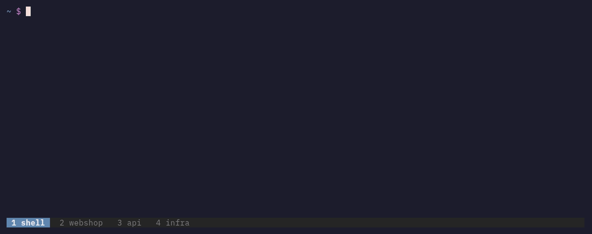
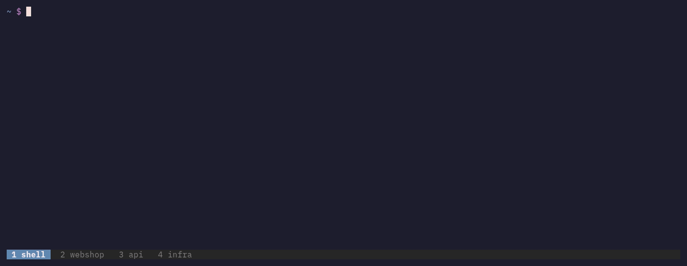

# ccctl

**Find, jump into and search your Claude Code sessions.**
Unofficial, not affiliated with Anthropic.

I use Claude Code all day, so I started writing small shell helpers for
it. Now all packaged into a single Go binary, for awesome speed and easy
install on macOS and Linux. That's it, Claude Code control: ccctl. Enjoy!

## Where is that session I had? Which window, which tab, which screen?



```sh
ccctl ps            # every running Claude Code session
ccctl focus <Tab>   # pick one by its title, land in its terminal
```

`focus` brings the session to the front: the iTerm2 tab, the
Terminal.app window or the tmux pane.

## Didn't I already have a session on …?



```sh
ccctl find "rate limit"
```

`find` searches every conversation in every project. My 1.5 GB, 8 months
of work, complete search in about a second (faster soon).

## Or all of it in one place (and now with quick view)


```sh
ccctl ui
```

`ccctl ui` shows all projects, all sessions and the running ones on one
screen. Enter resumes a session, or jumps to it while it runs. `:all`
flattens every session across every project into one list, sorted and
filtered how you like. Space on any row opens a quick-look overlay —
title, cwd, size, status and the first and last turn, read-only, no
jumping in. I really like [k9s](https://k9scli.io), so `ccctl ui`
works the same way, with `:views`, `j`/`k` and Enter.
Next: search as you type, right in `ccctl ui`.

## Move and rename

```sh
ccctl move <session> <dir>    # a session into another project
ccctl move <dir> <new-path>   # a directory, with its sessions, memory, settings and prompt history
```

Rename a project directory and keep every session. `--dry-run` shows
the plan first.

## And more

| | |
|---|---|
| `ccctl status` | projects, sessions, size at a glance |
| `ccctl sessions [dir]` | the sessions of a directory |
| `ccctl projects` | every project folder |
| `ccctl archive`, `ccctl restore` | pack a session into a `.zip`, and back |

`ccctl <command> --help` shows the details.

## Install

### Homebrew

```sh
brew install crux/tap/ccctl
```

Homebrew also installs the shell completion files.

### Go

```sh
go install github.com/crux/ccctl/cmd/ccctl@latest
```

`@main` installs the newest commit. `ccctl --version` then shows a Go
pseudo-version that names the commit.

### Direct download

Download `ccctl-<version>-<os>-<arch>.tar.gz` from the
[releases page](https://github.com/crux/ccctl/releases): `darwin` or
`linux`, `arm64` or `amd64`. The `.sha256` file next to it shows that
the download is complete. It does not prove where the file comes from.

ccctl is not notarized. After a download with a browser, macOS blocks
the first start. Remove the quarantine flag once:

```sh
xattr -d com.apple.quarantine ./ccctl
```

A download with `curl` does not set the flag.

## Shell completion

Homebrew installs the completion for you. If zsh does not load it, see
[Homebrew shell completion](https://docs.brew.sh/Shell-Completion).

For other installs, add one line to your shell configuration. The line
runs at every shell start, so the completion always matches the
installed ccctl.

```sh
# zsh: ~/.zshrc
command -v ccctl >/dev/null && source <(ccctl completion zsh)

# bash: ~/.bashrc (needs the bash-completion package)
command -v ccctl >/dev/null && source <(ccctl completion bash)

# fish: ~/.config/fish/config.fish
command -q ccctl; and ccctl completion fish | source
```

## What ccctl changes

Most commands only read. These commands change files:

- `move <session> <dir>` moves the files of one session from one project
  folder to another.
- `move <dir> <new-path>` renames the directory and its project folders.
  It copies the directory's settings in `~/.claude.json` and changes the
  project path in `~/.claude/history.jsonl`. It edits both files under
  Claude Code's own file lock. It refuses while Claude Code runs inside
  the directory.
- `archive` packs a session into `<session>.zip`. It checks the archive
  before it removes the original files. `restore` unpacks it again.

## Claude Code integration

`claude/commands/post-session-move-memory.md` is a Claude Code command.
After `ccctl move <session> <dir>`, run `/post-session-move-memory` in
the resumed session. It finds the memory files that the session wrote in
the old project folder, and helps you move, keep or remove each one.

```sh
make claude-install   # copy the command into ~/.claude/commands
make claude-check     # report a missing or changed copy
```

Without a clone of this repository (for example after a Homebrew
install), download the command directly:

```sh
mkdir -p ~/.claude/commands
curl -fsSL https://raw.githubusercontent.com/crux/ccctl/main/claude/commands/post-session-move-memory.md \
  -o ~/.claude/commands/post-session-move-memory.md
```

The repository holds the source. Change the command here, then run
`make claude-install`.

## Platform support

Tested on macOS 27 and Debian 13, with Claude Code 2.1.316. Windows is
not supported.

## Development

```sh
make help     # list the targets
make build    # bin/ccctl for this machine
make check    # go vet, tests, gofmt
make install  # the dev build into $(go env GOPATH)/bin
make demo     # render the GIFs in docs/demo/ (Docker; made-up sessions)
```

A dev build reports a Go pseudo-version: the last release, the commit
time and the commit, plus `+dirty` for uncommitted changes, for example
`ccctl version 0.1.1-0.20261102093000-abcdef123456+dirty`.

If Homebrew installed ccctl too, its copy usually comes first in PATH.
`brew unlink ccctl` lets the dev build win; `brew link ccctl` switches
back. `which -a ccctl` shows which copies exist.

## Releasing

For maintainers. Releases come only from CI.

1. Commit and push to `main`.
2. Run `make release VERSION=x.y.z`. The target checks the repo, creates
   the tag `vx.y.z` and pushes it.
3. The `Release` workflow runs the checks, builds the archives,
   creates the GitHub release with notes from the commit log, and
   updates the Homebrew formula in `crux/homebrew-tap`.

Secret: `HOMEBREW_TAP_TOKEN`, a fine-grained token with Contents read and
write on `crux/homebrew-tap` only. It expires on 2027-01-30. Before that,
create a new token and set it on every repo that publishes to the tap
(`gh secret set HOMEBREW_TAP_TOKEN --repo crux/<repo>`).

The moving parts: `Makefile`, `release.env`, `scripts/`,
`.github/workflows/`.

## License

MIT. See [LICENSE](LICENSE).
